<picture>
  <source media="(max-width: 600px)" srcset="./assets/hero-mobile.svg">
  
</picture>

  <a href="#sobre">Sobre</a> &nbsp; · &nbsp;
  <a href="#tecnologias">Tecnologias</a> &nbsp; · &nbsp;
  <a href="#projetos">Projetos</a> &nbsp; · &nbsp;
  <a href="#contato">Contato</a>

<h2 id="sobre">👋 Sobre mim</h2>

Sou **João Vitor Gonçalves**. Desenvolvo interfaces e APIs com **JavaScript, Node.js e React**, e também trabalho com **Vue e Quasar**.

Meus projetos incluem ferramentas de estudo, geração de documentos e APIs de livros. Atualmente, estou aprofundando meus estudos em **TypeScript, PostgreSQL e arquitetura em camadas** com o **Monitor de Sites e APIs**.

<h2 id="tecnologias">🛠️ Tecnologias</h2>

### Linguagens e back-end

  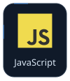
  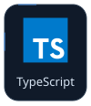
  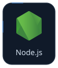
  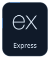
  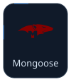

### Front-end

  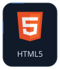
  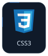
  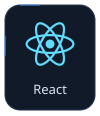
  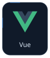
  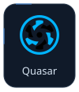
  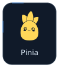

### Bancos de dados

  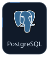
  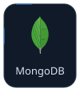

### Ferramentas

  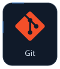
  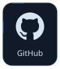
  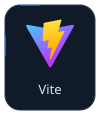
  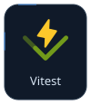
  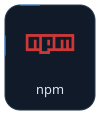

<h2 id="projetos">🚀 Projetos</h2>

| Projeto | Descrição e tecnologias |
| :--- | :--- |
| **🧭 Norte** [Site](https://joaovitorgoncalvesdev.github.io/norte-estudos/) · [Código](https://github.com/joaovitorgoncalvesdev/norte-estudos) | Planejamento de estudos, foco, questões, simulados e revisões, com o assistente NORBIT. HTML, CSS e JavaScript |
| **📄 FácilPDF** [Site](https://joaovitorgoncalvesdev.github.io/FacilPdf/) · [Código](https://github.com/joaovitorgoncalvesdev/FacilPdf) | Preenchimento de documentos, OCR e geração de PDF e Word no navegador. React, TypeScript, Vite, Tesseract.js e pdfmake |
| **📚 React Books** [Código](https://github.com/joaovitorgoncalvesdev/React-Books) | Interface de livros conectada a uma API Node.js. React, JavaScript, Node.js e Express |
| **🔌 API Biblioteca** [Código](https://github.com/joaovitorgoncalvesdev/api-biblioteca) | API REST para gerenciar livros e autores. Node.js, Express, MongoDB e Mongoose |
| **🏛️ Vitrine Glauber** 🔒 Privado | Vitrine dos boxes e produtos do Centro Cultural Glauber Rocha, com gestão separada. Vue 3, Quasar, JavaScript, Pinia e Vue Router |
| **📡 Monitor de Sites e APIs** 🛠️ Em desenvolvimento | Verificações HTTP, tempo de resposta e histórico no banco de dados. Node.js, Express, TypeScript e PostgreSQL |

<h2 id="contato">📫 Contato</h2>

  <a href="https://www.linkedin.com/in/jo%C3%A3o-vitor-gon%C3%A7alves-de-jesus-2968233b6/"> <b>João Vitor no LinkedIn</b></a>

